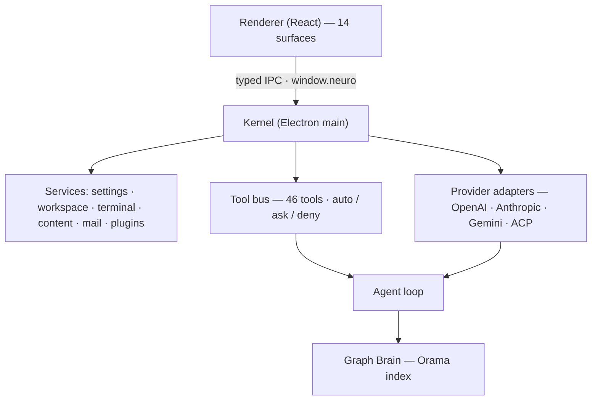

# Awesome-README Playbook — evidence from 15 top AI repos, applied to Neuro OS

Design brief for the Neuro OS `README.md`. Part 1–4 are the research (stable). Part 5–6 audit the
draft **as it exists right now** (it was being rewritten while this was written — line counts moved
from 279 → 1467 → 1868 during the review, so the audit is a snapshot, and Part 10 gives you a
re-runnable script instead of trusting line numbers).

Every claim about another repo comes from a README fetched directly from `raw.githubusercontent.com`
on 2026-11-06. Nothing is from memory or from search summaries.

---

## Part 0 — Sources actually fetched

| Key | Repo | URL fetched |
| --- | --- | --- |
| LC | langchain-ai/langchain | https://raw.githubusercontent.com/langchain-ai/langchain/master/README.md |
| OL | ollama/ollama | https://raw.githubusercontent.com/ollama/ollama/main/README.md |
| CP | ggml-org/llama.cpp | https://raw.githubusercontent.com/ggml-org/llama.cpp/master/README.md |
| VL | vllm-project/vllm | https://raw.githubusercontent.com/vllm-project/vllm/main/README.md |
| AG | Significant-Gravitas/AutoGPT | https://raw.githubusercontent.com/Significant-Gravitas/AutoGPT/master/README.md |
| CF | comfyanonymous/ComfyUI | https://raw.githubusercontent.com/comfyanonymous/ComfyUI/master/README.md |
| OW | open-webui/open-webui | https://raw.githubusercontent.com/open-webui/open-webui/main/README.md |
| DF | langgenius/dify | https://raw.githubusercontent.com/langgenius/dify/main/README.md |
| CR | crewAIInc/crewAI | https://raw.githubusercontent.com/crewAIInc/crewAI/main/README.md |
| TR | huggingface/transformers | https://raw.githubusercontent.com/huggingface/transformers/main/README.md |
| N8 | n8n-io/n8n | https://raw.githubusercontent.com/n8n-io/n8n/master/README.md |
| DS | deepseek-ai/DeepSeek-V3 | https://raw.githubusercontent.com/deepseek-ai/DeepSeek-V3/main/README.md |
| BU | browser-use/browser-use | https://raw.githubusercontent.com/browser-use/browser-use/main/README.md |
| LB | lobehub/lobe-chat | https://raw.githubusercontent.com/lobehub/lobe-chat/main/README.md |
| RF | infiniflow/ragflow | https://raw.githubusercontent.com/infiniflow/ragflow/main/README.md |

Closest sibling for Neuro OS: **BU** (multi-entry-point agent product, consumer + developer in one
file). Then **OW** (desktop + Docker + pip install paths, image/option tables) and **AG** (hosted vs
self-hosted split, comparison table).

---

## Part 1 — Structural teardown per repo (section order, as published)

**LC — langchain** (≈70 lines: a router, not a manual)
centered `<picture>` dark/light logo → `<h3>` tagline → 4 badges (license, pepy downloads, PyPI, X) →
one-liner → `> [!TIP]` → `## Quickstart` (`uv add` + 5-line Python) → ecosystem bullets (5) →
`## Why use LangChain?` (6 **bold-lead** ── em-dash bullets) → `---` → `## Resources` (6 described links).
No TOC, screenshots, benchmarks or license section.

**OL — ollama** (≈300 lines, **zero badges**)
centered logo → `# Ollama` → one-liner → `## Download` split into `### macOS / Windows / Linux /
Docker / Libraries / Community` (each a one-liner: `curl … | sh`, `irm … | iex`, plus "or download
manually") → `## Get started` → `### Coding` (`ollama launch claude`) → `### AI assistant` → `### Chat
with a model` → `## REST API` (curl + `### Python` + `### JavaScript`) → `## Supported backends` →
`## Documentation` → `## Community Integrations`: a ~100-entry, 10-category directory with one-line
descriptions each.

**CP — llama.cpp** (≈150 lines)
full-width SVG cover → centered `<b>` one-liner → **6 badges** (license, release, nightly, 3 CI
workflows) → 7 pipe-separated nav links → `## Quick start` (curl + pwsh one-liners, 5 alternative
paths, 2 run commands) → **two screenshots in a centered `<table>` with `<i>` captions** →
`## Description` (8 hardware bullets) → `## Supported backends` (**17-row table** backend × device) →
`## Documentation` (`#### Tools` / `#### Development`) → `## Contributing` (who may merge) →
`## Acknowledgements` (per-dependency license).

**VL — vllm** (≈120 lines, **zero badges**)
`<picture>` dark/light PNG → `<h3 align="center">` tagline → centered nav row (Docs | Blog | Paper |
Twitter | Forum | Slack) → `## About` (prose + 3 bullet groups + "200+ architectures" by family) →
`## Getting Started` (`uv pip install` + build-from-source link) → `## Contributing` →
`## Citation` (bibtex) → `## Contact Us` (channel per purpose, incl. security advisories) →
`## Media Kit`.

**AG — AutoGPT** (marketing funnel + self-host appendix)
clickable hero `.webp` (UTM-tagged) → centered `<h1>` + subhead → CTA row with `·` separators → 2
badges (Discord **dynamic member count**, Docker Hub) → narrative + **2-column persona table** →
embedded **MP4** demo + "45-second" framing + "edited and sped up" caveat → 3-step "how it works" →
`## Get started` (`### Platform` paid / `### Self-host` with `docker run`, `docker exec … promote`,
**hosted-vs-self-hosted table**) → `## Workflows` (4 bold-link bullets) → `## Build with us`
(**resource table**) → `## License` (**component × license × what it means**) → Classic pointer →
contributors image wall → CTA → 8 machine-translation links.

**CF — ComfyUI** (≈450 lines: one giant install manual)
centered `# ComfyUI` + bold tagline + **8 badges in 2 rows** + full-width screenshot → intro + 7
bullets → `## Get Started` (`### Local` → Desktop / Manual; `### Cloud`) → `## Examples` →
`## Features` (17 bullets with **nested per-modality model lists**) → `## Release Process` →
`## Shortcuts` (**~30-row keybind table**) → `# Installing` (Windows+Mac → Portable with 3 direct
downloads → comfy-cli → Manual by vendor: AMD Linux, AMD Windows with a **6-row GPU→extra table**,
Intel, NVIDIA **with inline `#### Troubleshooting`**, Ascend/Cambricon/Iluvatar) →
`## ComfyUI-Manager` (**flag table**) → `# Running` → `# Notes` → how-tos (previews, TLS) →
`## Support` → `## Frontend Development` → `# QA` (1 question → wiki).
No TOC, no roadmap, no license section (GPL only in `LICENSE`).

**OW — open-webui** (best install section of the set)
`<h2>` + `<p>` intro with inline bold/links → **22-language switcher row** → **clickable demo GIF** →
8 badges → CTA → `### Installation`: `#### Python` ("Then open localhost:8080"), `#### Docker`
(one `docker run`, **5-row image-tag table**, **4-row docker-option table**), `#### Desktop App` →
`### Ecosystem` → `### Troubleshooting and Updates` → `### Documentation` → `### Support` →
`### Security` (private advisories) → `### Star History` (`<picture>` dark/light) → `#### License`
(branding clause + `LICENSE_HISTORY`) → footer (Enterprise · Careers · Sponsor · creator).

**DF — dify** (badge-heavy, screenshot-light)
bare cover → CTA row with `·` → **13 badges** in 2 `<p>` blocks (product, pricing, 4 socials, Docker
pulls, commits, issues closed, discussions, 3× LFX health) → **18 language badges** → intro →
`## Quick start` (`>` blockquote system requirements → 4 commands → open `http://localhost/install` →
"the one-time `init_permissions` service is expected to exit with code 0") → `### Seeking help` →
`## Key features` (**numbered 1–7**, screenshot only under #2) → `## Using Dify` (Cloud / Self-host /
Enterprise) → `## Staying ahead` → `## Advanced Setup` → `## Contributing` → `## Community & contact`
(channel + when to use it) → `## Star History` (`#gh-light-mode-only` trick) → `## Security
disclosure` → `## License`. No TOC, no benchmarks, no comparison table.

**CR — crewAI** (most complete developer onboarding)
centered logo → Trendshift badge → pipe nav → 3 badge rows → `<h3>` tagline → blockquote → 2 concept
bullets → social proof → `# AMP Suite` (7 bullets) → **`## Table of contents`** → `## Build with AI`
(**install prompts per coding agent** + **skill table**) → `## Why CrewAI?` → `## Getting Started`
(YouTube thumbnail-as-link, Learning Resources, Flows vs Crews, then `### 1. Installation` with
Python version check, per-OS uv commands + wget fallback, **PATH fix**, **known Windows
`chroma-hnswlib`/`float.h` fix**, expected `uv tool list` output, upgrade command) → ASCII project
tree → JSONC examples → `## Key Features` → `## Examples` → `## Connecting Your Crew to a Model` →
`## When to Use CrewAI` → `## Contribution` (clone/test/mypy + docs-freeze policy) → `## Telemetry`
(what, why, and `OTEL_SDK_DISABLED=true`) → `## License` → `## Frequently Asked Questions` (20 Q&A).

**TR — transformers** (best progressive disclosure)
`<picture>` dark/light logo → 7 badges (incl. an HF endpoint badge and a DOI) → **21-language row** →
`<h3>` tagline → **conceptual diagram** → positioning prose → `## Installation` (version pins, venv
**and** uv, from source with "may not be stable") → `## Quickstart` (pipeline code **with printed
output**, `> [!TIP]` CLI, chat) → **3 `<details>`** (ASR / image classification / VQA, image + code +
output) → `## Why should I use Transformers?` (4 numbered groups) → **`## When shouldn't I use
Transformers?`** → `## 100 projects using Transformers` → `## Example models` (**4 `<details>`**) →
`## Citation`. No TOC, no license section (badge only), no benchmarks.

**N8 — n8n** (shortest product README, **zero badges**)
banner → `# n8n – The Platform for AI Agents and Workflow Automation` → one-liner → screenshot →
`## Key Capabilities` (6 bold-lead bullets) → `## Quick Start` (curl install script; `docker run`;
"Access the editor at http://localhost:5678") → `## Resources` (emoji links) → `## Support` →
`## License` (fair-code + 3 defining bullets) → `## Contributing` → `## Join the Team` →
`## What does n8n mean?` (personality FAQ with a founder quote).

**DS — DeepSeek-V3** (paper-style, most disciplined numbering)
centered logo 60% → `<hr>` → badge grid in 3 rows + bold "Paper Link 👁️" → **`## Table of Contents`**
(1–9) → `## 1. Introduction` (+ benchmark PNG) → `## 2. Model Summary` (three `---` blocks with bold
lead-ins) → `## 3. Model Downloads` (**5-column table** + `> [!NOTE]` on the 685B vs 671B
discrepancy) → `## 4. Evaluation Results` (**3 large comparison tables**, best-in-bold, +
`> [!NOTE]` caveats: "gap ≤ 0.3 = same level", "output limited to 8K") → `## 5. Chat Website & API`
→ `## 6. How to Run Locally` (**8 numbered backends, 4 "recommended"**, then 6.1–6.8 each with a
system-requirement note and commands) → `## 7. License` (code MIT ≠ model license) → `## 8. Citation`
→ `## 9. Contact`. No screenshots, no architecture (it is in the paper), no FAQ, no roadmap.

**BU — browser-use** (closest model for Neuro OS)
full-bleed `<picture>` banner (light/dark) → centered `<picture>` wordmark → custom PNG download badge
→ `---` → badge-nav row from **custom PNG badges separated by invisible spacer images** → hero image
→ one-liner carrying the price and the benchmark score → `# Navigate the web like a human does.` +
**GIF** + "Explore more demos ↗" → **blockquote pointing AI agents at `llms.txt`** → `# Which Browser
Use do I need?` (**responsive SVG decision diagram** + 3 anchor links) → `# Quickstart` split into `##
Path 1: Fully Hosted Cloud` / `## Path 2: CLI` (**a copy-paste prompt for coding agents**) / `##
Path 3: Python Library` (5 numbered steps, `.env`, code, expected behaviour) → `# Toolsets for
Claude` (architecture SVG + SDK code) → `# Benchmark v2` (image + honest "60-task subset") → `# FAQ`
(**11 `<details>`**, incl. CAPTCHA with a "no configuration guarantees" disclaimer) →
`## Related Repositories` (**7-row table**) → `## Citation` → footer.

**LB — lobehub** (maximum markdown craft)
`<div align="center"><a name="readme-top">` → banner → `# LobeHub` + tagline + language row →
`<!-- SHIELD GROUP -->` + 3 badge rows → 7 "share" badges → PH + Trendshift + Vercel →
**TOC inside `<details><summary><kbd>`** → bare video URL → `## Getting Started` (2-row table pairing
a PH badge with prose) → `> [!IMPORTANT] Star Us` → Star History in `<details>` → `## Features` (**4
themed subsections**, each prose + bullets + image + right-aligned **back-to-top badge**) →
`## Self Hosting` (`A` **5-column deploy-button table**; `B` Docker in 3 steps; **`### Environment
Variable` 4-column table**; `### Obtain OpenAI API Key` with a **3-screenshot table** and a provider
table + `> [!WARNING]`) → `## Ecosystem` (**table with a version badge per row**) → `## Plugins` →
`## Local Development` (Codespaces badge, clone, a "debug proxy" caveat) → `## Contributing`
(maintainers named, 3 submit badges) → contributors as a **`<table>` with contrib.rocks + 2 OSS
Insight widgets in `<picture>`** → `## Sponsor` → `## More Products` → License in `<details>` →
copyright → **a 120-line link-reference block**.

**RF — ragflow** (best product-tour ordering)
centered logo SVG → **11 language badges** → 5 badges (incl. an endpoint JSON badge) → `<h4>` nav
(Cloud | Documentation | Roadmap | Discord) → **Octoverse screenshot** (social proof above the fold)
→ Trendshift → **`<details open>` TOC with emoji bullets** → `## 💡 What is RAGFlow?` → `## 🎮 Get
Started` (+ **2 demo GIFs**) → `## 🔥 Latest Updates` (**5 dated bullets**) → `## 🌟 Key Features`
(8 emoji groups) → `## 🔎 System Architecture` (**image**) → `## 🏠 Local Deployment` (prereqs incl.
hardware, 6 steps, healthcheck `curl`, `docker logs --tail 50`) → `## 🔨 Launch from Source` (7 steps,
"four terminals", then each `--flag` explained) → `## 📚 Documentation` → `## 📜 Roadmap` (issue link)
→ `## 🏄 Community` → `## 🙌 Contributing`.

---

## Part 2 — Cross-repo element matrix

`✓` present, `~` link-out only, `·` absent.

| Element | LC | OL | CP | VL | AG | CF | OW | DF | CR | TR | N8 | DS | BU | LB | RF | n |
|---|---|---|---|---|---|---|---|---|---|---|---|---|---|---|---|---|
| Hero logo/banner (centered) | ✓ | ✓ | ✓ | ✓ | ✓ | ✓ | · | ✓ | ✓ | ✓ | ✓ | ✓ | ✓ | ✓ | ✓ | 14 |
| Single-sentence positioning | ✓ | ✓ | ✓ | ✓ | ✓ | ✓ | ✓ | ✓ | ✓ | ✓ | ✓ | ✓ | ✓ | ✓ | ✓ | 15 |
| Badge row | ✓ | · | ✓ | · | ✓ | ✓ | ✓ | ✓ | ✓ | ✓ | · | ✓ | ✓ | ✓ | ✓ | 12 |
| Quickstart in the first screen | ✓ | ✓ | ✓ | ✓ | ✓ | ✓ | ✓ | ✓ | ✓ | ✓ | ✓ | · | ✓ | ~ | ✓ | 13 |
| Screenshot / GIF / video | · | · | ✓ | · | ✓ | ✓ | ✓ | ✓ | ~ | · | ✓ | · | ✓ | ✓ | ✓ | 10 |
| Feature bullets w/ **bold lead-in** | ✓ | · | ✓ | ✓ | ✓ | ✓ | ✓ | · | ✓ | ✓ | ✓ | ✓ | · | ✓ | ✓ | 11 |
| Docs/community link cluster | ✓ | ✓ | ✓ | ✓ | ✓ | ✓ | ✓ | ✓ | ✓ | ~ | ✓ | ✓ | ✓ | ✓ | ✓ | 15 |
| Contributing section | ~ | · | ✓ | ✓ | ✓ | · | · | ✓ | ✓ | · | ✓ | · | · | ✓ | ✓ | 8 |
| License section | · | · | · | · | ✓ | · | ✓ | ✓ | ✓ | · | ✓ | ✓ | ~ | ✓ | · | 7 |
| ≥1 real table | · | · | ✓ | · | ✓ | ✓ | ✓ | · | ✓ | · | · | ✓ | ✓ | ✓ | · | 8 |
| Provider/model support list | · | ✓ | ✓ | ✓ | · | ✓ | ✓ | ✓ | · | ✓ | · | · | · | ✓ | · | 7 |
| Multiple install paths | · | ✓ | ✓ | ~ | ✓ | ✓ | ✓ | · | ✓ | ✓ | ✓ | ~ | ✓ | ✓ | ✓ | 12 |
| Architecture diagram | · | · | · | · | · | · | · | · | ~ | ✓ | · | · | ✓ | · | ✓ | 3 |
| Comparison table | · | · | · | · | ✓ | · | · | · | · | · | · | ✓ | · | ✓ | · | 3 |
| Benchmarks with numbers | · | · | · | · | · | · | · | · | · | · | · | ✓ | ✓ | · | · | 2 |
| Inline FAQ | · | · | · | · | · | ~ | ~ | ~ | ✓ | · | ✓ | · | ✓ | · | ~ | 4 |
| Inline troubleshooting | · | · | · | · | · | ✓ | ~ | · | ✓ | · | · | · | · | · | ~ | 2 |
| Roadmap | · | · | · | · | · | · | ~ | · | · | · | · | · | · | · | ✓ | 1 |
| Security / disclosure | · | · | · | ~ | · | ~ | ✓ | ✓ | ~ | · | · | · | ~ | · | · | 3 |
| Explicit limitations / non-goals | · | · | · | · | · | ✓ | · | · | ~ | ✓ | · | ~ | ✓ | · | · | 4 |
| i18n language switcher | · | · | · | · | ✓ | · | ✓ | ✓ | · | ✓ | · | · | · | ✓ | ✓ | 6 |
| Table of contents | · | · | · | · | · | · | · | · | ✓ | · | · | ✓ | · | ✓ | ✓ | 4 |
| Citation block | · | · | · | ✓ | · | · | · | · | · | ✓ | · | ✓ | ✓ | · | · | 4 |
| Social proof (stars/awards/walls) | · | · | · | · | ✓ | · | ✓ | ✓ | ✓ | · | · | · | ✓ | ✓ | ✓ | 7 |
| `<details>` collapsibles | · | · | · | · | · | · | · | · | · | ✓ | · | · | ✓ | ✓ | ✓ | 4 |
| End-user install one-liner | · | ✓ | ✓ | · | ✓ | ✓ | ✓ | · | · | · | ✓ | · | ✓ | ✓ | ✓ | 8 |

---

## Part 3 — Ranked: elements successful AI repos actually share

Ordered by frequency × observed effect. "n" = of 15 fetched READMEs.

1. **One-sentence positioning under the name** — n=15. Universal. Best ones are comparative or
   quantitative: VL "Easy, fast, and cheap LLM serving for everyone"; CP "LLM inference in C/C++";
   BU "…top score (90.5%)".
2. **Centered hero identity block** (logo + name + one-liner + badges as one unit) — n=14. LC, VL, TR,
   BU ship dark/light logo pairs via `<picture>`.
3. **Copy-pasteable quickstart above the first scroll** — n=13. The README is judged by whether a
   command can be pasted in 10 seconds. OL/CP/N8 use a single `curl … | sh`.
4. **A badge row** — n=12, but *content* separates signal from noise. Consensus set: version, license,
   downloads/stars, build, community size. DF's 13 and LB's 20+ are the cautionary case.
5. **Feature bullets with a bold lead phrase** — n=11. LC "**Model interoperability** — swap models…";
   CR "**Flows for control**: …"; N8 "**Code When You Need It**: …". Nobody reads full sentences in a
   feature list; everybody reads the bold half.
6. **A visual of the product** — n=10. GIFs (BU, OW, RF), MP4 (AG), one big screenshot (CF, N8),
   captioned two-up table (CP). Products without UI substitute a diagram or benchmark chart (VL, DS,
   TR).
7. **A docs/community link cluster near the end** — n=15. Every repo routes outward. LC and VL are
   almost *only* this.
8. **Multiple install paths, branched by user type** — n=12. Per-OS (OL, CP), per GPU vendor (CF),
   hosted vs self-hosted (AG, DF), desktop vs portable vs source (CF), cloud vs CLI vs library (BU).
9. **At least one genuinely useful table** — n=8, always one of four kinds: compatibility (CP's 17-row
   backends, CF's GPU→extra), configuration (OW docker options, LB env vars, CF flags), catalogue
   (DS model downloads, LB ecosystem), results (DS benchmarks).
10. **Support matrix: which providers/models work** — n=7. OL turns it into a 100-entry directory;
    VL/CF list families; DF screenshots a provider grid.
11. **Contributing** — n=8, in two modes: *policy* (CP: who may merge) vs *copy-paste environment*
    (CR: clone/test/mypy). The second converts far better.
12. **License, often with nuance** — n=7. AG's component table and DS's code-vs-model split are the
    honest pattern; a lone badge is the lazy pattern (TR).
13. **Architecture / mental model** — n=3 (TR, RF, BU). Rare, and disproportionately valuable in agent
    products where the trust question is "what can it touch?".
14. **FAQ** — n=4 inline (CR 20, BU 11, N8 1, CF 1) + 4 link-outs. Correlates with consumer products.
15. **Explicit limitations / non-goals** — n=4 (TR, BU, CF, CR). TR's `## When shouldn't I use
    Transformers?` is the highest-trust paragraph in the corpus.
16. **Security / disclosure** — n=3 (OW, DF, VL). Mandatory for anything that runs code or holds keys.
17. **Benchmarks with numbers** — n=2 (DS, BU). Both wrap numbers in caveats; the caveat is what makes
    them credible.
18. **TOC** — n=4, all long-form (CR, DS, LB, RF). Below ~200 lines nobody bothers.
19. **Citation** — n=4, research-adjacent only.
20. **i18n switcher** — n=6. Cheap reach, real maintenance cost (OW lists 22; a stale one is a dead
    link in 22 places).

---

## Part 4 — What separates *great* from merely *complete*

A complete README has every section. A great one is **faster to disprove and easier to trust**.

**1. The five-second test is won above the fold.** Hero + one sentence + one command. VL's entire
above-fold is a logo, 7 words and a nav row; BU puts the price and the score in the description line.
No top-tier README buries install below three paragraphs.

**2. Commands are complete and include the "then what".** OW: `pip install` → `serve` → "Then open
localhost:8080". DF tells you the one-time init service *exits with code 0* so you don't file a bug. CR
shows the expected `uv tool list` output. TR prints the model's actual output. Pattern: **command →
expected result → next action.**

**3. Failure modes are documented where they occur.** CR ships the `PATH` fix and the exact Windows
`chroma-hnswlib`/`float.h` error with its remedy. CF: "update your Nvidia drivers if it doesn't start".
DS puts "Mac and Windows are not supported" *inside* the section that would fail there. Highest-value,
lowest-effort differentiator in the whole corpus.

**4. Branch by user intent, not by feature taxonomy.** BU's decision diagram with three anchored paths.
AG's hosted-vs-self-hosted table before any command. CF: "Regular users should use the desktop app
above" — it argues you out of the hard path.

**5. Tables for anything with ≥2 attributes; prose only for "why".** Compare CF's 30-row keybind table
with any sentence-based shortcut list. Tables survive skimming and translation.

**6. Progressive disclosure instead of truncation.** TR hides every modality sample in `<details>`; BU
hides 11 FAQs; LB hides TOC, star history and license. The file can be 150 lines *and* 900 lines.

**7. Honest scoping beats confident vagueness.** TR "not a modular toolbox…"; BU "no configuration
guarantees every CAPTCHA can be solved"; DS "gap ≤ 0.3 = same level"; AG "edited and sped up". Each
caveat raises credibility.

**8. The trust surface is explicit.** OW/DF: security disclosure channel. CR: a full telemetry section
listing every field, why, and the env var to disable it. AG: per-directory license table. For an agent
that runs shell commands this is not polish.

**9. Social proof is low, and specific.** Star-history charts (OW, DF, LB), contributor walls (AG, DF,
LB), Trendshift/PH (CR, LB, RF), Octoverse (RF). None above the install command — it converts the
undecided who already scrolled.

**10. The product is shown in motion, captioned.** BU's GIF is captioned with the task ("Find an
available slot, pick a date and time, handle the CAPTCHA"); CP captions each screenshot in `<i>`; AG
labels its video as edited. An unlabelled GIF makes the reader guess.

**11. Personality appears once, near the end.** N8's "What does n8n mean?"; BU's "Made with ❤️ in
Zurich and San Francisco"; LB's maintainer handles.

**12. Machine-readable entry points are appearing.** BU points agents at `llms.txt`; CR's "Build with
AI" ships copy-paste prompts to install its skills into Claude Code/Cursor/Codex. On-brand for a
product built *for* agents.

---

## Part 5 — Recommended skeleton for the Neuro OS README

Order: **what it is → see it → get it → what it does → what it can touch → how it works → what it
can't do → build on it.** Last column = state of the draft at this snapshot.

| # | Section | One-line purpose | Steal from | In the draft today |
|---|---|---|---|---|
| 1 | **Hero**: dark/light wordmark, `<h1>`, one-liner, OS download CTAs, 5 badges | Answer "what is this, can I install it" before any scroll | BU, CP, OW | ✅ logo + tagline + 7 badges + anchor nav + hero screenshot; ⚠️ badges are stack-led (Electron/React/TS/ACP) — no version, downloads or community |
| 2 | **Demo** — 15–30 s GIF/MP4 of one flow (prompt → plan → approval card → result), captioned | Prove the agent loop is real | BU, AG, RF | ❌ **no `.gif`/`.mp4`/`.webm` anywhere** — the one missing tier-1 element |
| 3 | **What it is / what it isn't** | Set the category before features | LC, TR | ✅ "not a chat window with a sidebar" |
| 4 | **Non-goals** ("When *not* to use it") | Save the wrong reader 20 minutes | TR | ✅ strongest trust move in the file — keep it |
| 5 | **Install (end users)** — `winget` / `brew` / `.dmg` / `.exe` / `.AppImage` + "or from source ↓" | The 10-second path for a desktop app | OL, OW, CF | ❌ **no winget/brew/dmg/AppImage/deb/curl**; `## Quick start` is `git clone` + `npm install` |
| 6 | **System requirements** (OS / RAM / disk / GPU / Node) | Prevents the commonest failed install | RF, CF | ✅ Requirements block (Node 20+, Windows 10/11, ~600 MB) |
| 7 | **First run** — numbered steps to a working agent turn | Converts install into success | OW, CR | ✅ `### First run` + `## Your first ten minutes` |
| 8 | **Quick start from source** — demoted under install | Serve contributors without confusing users | CF | ✅ (currently the *only* install path) |
| 9 | **Feature tour** — one `###` per surface, 1 visual + 2–3 bullets | Jump-to-surface navigation | CF, RF, DF | ✅ `## The surfaces` (13 H3s), `## What's inside` table |
| 10 | **Screenshots** — hero shots + `<details>` gallery | Show it without a 40-screen scroll | LB, TR | ✅ `## Screenshots` with **`<details>` for all 30** — exactly right |
| 11 | **Works with** — Provider / Kind / Base URL / Local? table | Answers "my model? offline?" | OL, VL, LB | ✅ 14-preset table with a **Local?** column — better than any repo in the corpus |
| 12 | **Architecture** — one diagram + "one X" bullets | The mental model and the trust map | RF, TR | ✅ box-drawing diagram, clean UTF-8, seams explained |
| 13 | **Security & permissions** — tool policies, keychain, egress, disclosure contact | Non-negotiable when you run ConPTY | OW, DF, CR | ✅ `## Security & privacy`, `## Permissions & approvals`, red-team link; ⚠️ no external disclosure channel |
| 14 | **Privacy & data** — where state lives, what leaves, how to wipe | Desktop-app specific; nobody in the corpus does it well | (format: LB env table) | ✅ `## Data & storage` |
| 15 | **Extend** — plugin manifest snippet + install-from-URL | Turn readers into builders | BU, CR, LB | ✅ `## Plugins & the marketplace` (manifest, runtime API, lifecycle) |
| 16 | **Why / how it compares** — 5-row table vs ChatGPT desktop, Claude, Cursor, VS Code | Pre-empts "why not just X", honestly | AG, DS, TR | ⚠️ `## Why Neuro OS` + non-goals, but no head-to-head table |
| 17 | **Limitations** — the honest list | Highest-trust section | TR, BU, CF | ✅ 13 items, mapped to red-team findings |
| 18 | **Status / roadmap** — Now / Next / Later | Kills "abandoned?" | RF, OW | ✅ `## Roadmap` |
| 19 | **FAQ** — 8–12 `<details>` (free? key? offline? my data? Windows-only? plugin safety?) | Absorbs recurring questions | BU, CR, N8 | ❌ absent — the biggest content gap after the demo |
| 20 | **Troubleshooting** — symptom → fix tables | Turns support load into docs | CF, CR | ✅ two tables (install & launch, models & agent) — 10 real symptoms |
| 21 | **Community & contributing** | User → contributor path | CR, CP, LB | ✅ `## Contributing`; ❌ **no `CONTRIBUTING.md`**, no Discord/Discussions link (one passing mention) |
| 22 | **Testing & QA** | Proof, not claims | (no peer) | ✅ unique in the corpus — a documented headless harness |
| 23 | **Performance notes** | Sets expectations | (no peer) | ✅ unique in the corpus |
| 24 | **License & credits** | Legal clarity | AG, DS, N8 | ⚠️ `## License` says MIT "see `package.json`"; ❌ **no `LICENSE` file exists** |
| 25 | **Footer** — version, back to top, one human line | Close the loop | LB, BU, N8 | ✅ v1.0.0 · build · back to top; ⚠️ no human/community line |

---

## Part 6 — Audit of the current draft

Snapshot: **1868 lines / 92 KB / 30 `##` sections / 377 table rows / 23 code blocks / 9 ``**.
The draft is already better than most of the corpus on **tables, provider matrix, troubleshooting,
limitations and security** — five areas where even OW and DF are weaker. The remaining work is
narrow and specific.

### 6.1 What is already best-in-class (do not "improve" these)
- **Providers table with a `Local?` column.** No repo in the corpus answers "can I run this offline"
  in the table itself.
- **`### When *not* to use it`.** Only TR does the equivalent. It is the strongest trust signal in the
  file.
- **Troubleshooting as symptom → fix tables**, split by failure domain. CF and CR are the only peers.
- **Limitations cross-referenced to red-team findings** (`X-01`, `docs/REDTEAM.md`). No peer has this.
- **Testing & QA + Performance notes.** Neither exists in any of the 15 repos.
- **TOC as a three-column table** (Start here / Build with it / Understand it). Better than DS's
  numbered list or CR's nested list — it encodes reader intent.
- **Screenshots behind one `<details>`.** Correct progressive disclosure.

### 6.2 Gaps, in priority order

**A. No motion.** Zero `.gif`/`.mp4`/`.webm`. Every consumer-facing agent product in the set leads with
one (BU, OW, RF, AG). A tool-approval turn is the single most differentiating 8 seconds of this product
and it currently cannot be seen. *Fix: one captioned GIF at the hero, ≤8 MB, showing prompt → plan →
approval card → tool result.*

**B. No end-user install path.** Zero `winget`, `brew`, `.dmg`, `.AppImage`, `.deb`, `curl … | sh`. The
only way in is `git clone` + `npm install` + `npm run dev`. For a desktop app, that is a developer
README with a consumer product behind it. OL/OW/CF/BU all treat download as the headline and source as
the fallback. *Fix: three platform rows (even "no signed build yet — here is the honest status"), then
demote source build. If no installers exist yet, say so in one line and give the portable `.exe` path
that `npm run dist:win` / `pack:win` already produces.*

**C. No FAQ.** 0 occurrences. BU (11 `<details>`) and CR (20 Q&A) show the pattern; the questions are
predictable: free? account? API key needed? offline? where is my data? Windows only? are plugins safe?
can mail leave my LAN? *Fix: 8–10 `<details>` placed after Limitations.*

**D. No `LICENSE` file.** `## License` says MIT "see `package.json`", and GitHub will show no license
sidebar entry. 7 of 15 repos have a license section and all of them link a real file. *Fix: add
`LICENSE`, keep the README line.*

**E. No `CONTRIBUTING.md`, no community channel.** `## Contributing` exists, but there is no setup
brief, no PR conventions, and no Discord/Discussions link (one incidental mention). CR's inline block
(clone → test → mypy → PR rules) is the model; LB names maintainers. *Fix: `CONTRIBUTING.md` + one
"Community" row in the footer.*

**F. Length: 1868 lines is a manual, not a front door.** Not fatal — CF is 450 and AG is a funnel — but
7 of the deep sections already have canonical files in `docs/` (`ARCHITECTURE.md` 23 KB, plus
`PLUGINS.md`, `MAIL.md`, `AUTOMATION.md`, `WEB.md`, `BRAIN.md`, `COMPOSIO.md`, `EXTENDING.md`), and the
README links into `docs/` 49 times. That means **two copies of the same explanation** with different
levels of detail, which will drift. *Fix: keep 5–10 line summaries for Mail, Neuro Web, Automation,
Plugins, Brain and Tools reference + a "Full detail →" link, and move the long-form bodies into the
existing docs (or delete the docs and make the README canonical — pick one).* This alone takes the
file to ~700–900 lines without losing a fact.

**G. No dark/light assets.** Zero `<picture>` / `prefers-color-scheme`. The logo is a light-only PNG and
the 30 screenshots are single-theme — in dark mode GitHub shows a white box (and this product ships 4
themes, so the irony is visible). *Fix: `<picture>` pair for the logo; two screenshots (desktop, chat)
as dark/light pairs.*

**H. No GitHub alert callouts.** Zero `> [!NOTE]` / `[!WARNING]`. The draft uses `> **Unsigned
builds.**` blockquotes, which is fine, but the plugin-safety and unsigned-build warnings are exactly
what `> [!WARNING]` is for — LC, DF, LB, RF, TR and DS all use it.

**I. No `llms.txt`.** BU points coding agents at one. Neuro OS is aimed at people who run coding
agents. *Fix: `llms.txt` + a 3-line "install with your coding agent" block.*

**J. No head-to-head comparison.** "Why Neuro OS" argues the category, "When *not* to use it" argues
scope, but there is no 5-row table against ChatGPT desktop / Claude / Cursor / VS Code, including a
column where the competitor wins. AG and DS show the format.

**K. Badge set.** "Quick start", "No telemetry" and "License" are good; Electron/React/TypeScript/ACP
are stack facts that belong in Architecture. Add release version + downloads + community size.

**L. One `<details>` only.** Tools reference (≈97 lines), Keyboard shortcuts, and the plugin runtime API
are all collapsible candidates (TR/LB pattern). The screenshots block proves the instinct is right.

**M. Footer has no human line.** N8 ("What does n8n mean?"), BU ("Made with ❤️"), LB (maintainers)
all end with one. The current footer is version + back-to-top only.

### 6.3 Encoding: regression risk, not a current defect
The earlier draft (279 lines) was double-encoded: 337 `â`-mojibake characters, zero box-drawing
characters, so the architecture diagram rendered as `┌──`. The current draft is clean — 0 mojibake,
120 real em dashes, box-drawing intact, valid UTF-8. Keep it that way with a pre-commit check
(`Part 10`). This matters because box-drawing ASCII art is the most fragile content type in a README.

### 6.4 Length budget
Target ≤ 900 lines rendered, ≤ 60 above the fold. Today: 1868. The cut comes from 6.2-F (docs
duplication), not from deleting content.

---

## Part 7 — Anti-patterns (with evidence)

1. **Badge soup.** DF stacks 13 badges + 18 language badges before the product sentence; LB has 3
   groups + 7 share badges + 3 awards. The one-liner gets pushed below the fold. *Rule: ≤6 functional
   badges above the fold; language links in one plain row or a `<details>`.*
2. **Stack badges instead of project badges.** True, but persuasive to nobody.
3. **Wall of text with no scannable unit.** AG's sections are 4–6 sentence paragraphs and lean on
   tables/video to compensate. *Rule: no paragraph >3 lines without a table, list or subhead.*
4. **Stale or fragile screenshots.** DF/CF/BU use `user-attachments` IDs or S3 URLs: not diffable,
   invisible to reviewers, silently breakable. Repo-relative paths (`screenshots/…`) — what Neuro OS
   already does — are the correct choice; the risk is forgetting to re-shoot after a redesign.
5. **Undocumented flags.** CF shows `--offline`, `--disable-partner-nodes`, `--enable-manager`,
   `--front-end-version` and explains each in a table (good case). The anti-pattern is a flag in a
   command with no explanation, so the reader cannot know what is safe to drop.
6. **Silent version requirements.** CR pins `>=3.10 and <3.14`; CF spends 6 lines on Python/torch
   ranges. The anti-pattern is an unpinned install that fails for half the audience.
7. **Unverifiable claims.** A benchmark image with no sample size or date is worse than none. BU's
   "60-task subset" and DS's "≤0.3 = same level" are the fix.
8. **A README doing two incompatible jobs.** AG is a funnel and works only because a separate
   `autogpt_platform/README.md` exists for developers. Doing both badly in one file is the failure mode.
9. **Burying the manual in the front door.** RF's source build is 7 steps across "four terminals"; CF
   is a 450-line install manual where a new user scrolls past six GPU vendors to find the desktop app.
   Correct: 2 steps inline + a link.
10. **Hand-maintained TOCs with emoji headings.** RF/LB emoji-prefixed headings make slugs
    unpredictable and typos likelier. Prefer plain headings, or explicit `<a name="…">` targets.
11. **i18n links you cannot maintain.** OW lists 22 translations; a stale translation is a dead link in
    22 places. Six is a sane ceiling without a translation pipeline.
12. **Repeating the same CTA.** LB repeats "Star us" three times plus a chart plus a sponsor block. Once,
    at the end.
13. **Emoji as structure.** Reads well on GitHub, breaks in screen readers and plain-text mirrors.
14. **Mojibake from encoding round-trips.** Box-drawing characters and em dashes are the first
    casualties — the earlier Neuro OS draft is the example.

---

## Part 8 — Markdown tricks used by the big repos (with snippets)

**1. Dark/light logo via `<picture>`** (LC, VL, TR, BU, LB, OW)
```html
<p align="center">
  <picture>
    <source media="(prefers-color-scheme: dark)"  srcset="resources/brand/wordmark-dark.svg">
    <source media="(prefers-color-scheme: light)" srcset="resources/brand/wordmark-light.svg">
    
  </picture>
</p>
```
A light-only PNG is the most common reason a README looks broken to half of GitHub's users.

**2. Reference-style badge groups** (LB, CF, CP) — readable line, one-line removal:
```markdown
[![][release-shield]][release-link] [![][license-shield]][license-link] [![][discord-shield]][discord-link]

[release-shield]: https://img.shields.io/github/v/release/owner/neuro-os?style=flat-square
[release-link]:   https://github.com/owner/neuro-os/releases
```
LB takes it furthest: a 120-line "LINK GROUP" defines every image, badge and URL once.

**3. Badge alignment without tables** (BU) — invisible spacers:
```html
<a href="#demo"></a>
<a href="docs"></a>
```

**4. Centered blocks without CSS** (AG, BU, RF) — `<div align="center">` for groups, `<p align="center">`
for one image, `<h1 align="center">` / `<h3 align="center">` for name and tagline.

**5. `<details>` progressive disclosure** (TR, BU, LB, RF) — highest-leverage trick:
```html
<details>
<summary><b>Does Neuro OS work offline?</b></summary>

Yes. Models served by Ollama, LM Studio or vLLM stay on your machine; only the calls you
make leave the process.
</details>
```
TR wraps 7 code samples, BU 11 FAQs, LB the TOC/star history/license. Use `<details open>` (RF) when
content should be visible by default but still collapsible.

**6. `<kbd>` affordance in TOC summaries** (LB): `<summary><kbd>Table of contents</kbd></summary>`.

**7. Stable anchor + back-to-top badge** (LB):
```html
<div align="center"><a name="readme-top"></a>
...
<div align="right"><a href="#readme-top"></a></div>
```

**8. GitHub alert syntax** (LC, DF, LB, RF, TR, DS) — coloured callout on GitHub, blockquote elsewhere:
```markdown
> [!NOTE]
> Keys are encrypted with the OS keychain (DPAPI on Windows) and never leave the machine.

> [!WARNING]
> Plugins run native code in the main process. Install plugins you trust.
```
LC/DF use `[!TIP]` to upsell; DS uses `[!NOTE]` for methodology caveats; LB uses `[!IMPORTANT]` for the
star CTA. Keep to NOTE/WARNING/TIP.

**9. Tables as compatibility matrices** (CP, CF, OW, DS, LB):
```markdown
| OS | Installer | Command | Auto-update |
| --- | --- | --- | --- |
| Windows 11 | `.exe` (NSIS) + portable | `winget install NeuroOS` | Yes |
| macOS 14+ | `.dmg` (arm64, x64) | `brew install --cask neuro-os` | Yes |
| Linux | `.AppImage`, `.deb` | `curl -fsSL https://neuro.os/install.sh \| sh` | AppImage only |
```
DS's model table is the cleanest catalogue-as-table; LB's env table (Variable / Required / Description /
Example) the cleanest config-as-table.

**10. Mermaid instead of box-drawing ASCII** — GitHub renders it, it diffs, and it cannot be mojibake'd:

````markdown

````
If plain text is required (terminal viewers), draw with `+ - |` only — never `┌ ─ │ ├`.

**11. Anchors that always work.** Prefer explicit targets: `<a id="security"></a>` + `[Security](#security)`.
DF's `#gh-light-mode-only` / `#gh-dark-mode-only` URL fragments swap one image per theme:
```markdown
 
```

**12. Directory tree in a fenced block** (CR; already in the draft) — `text` fence, ASCII only.

**13. Captioned screenshots in a centered two-up table** (CP):
```html
<table align="center">
  <tr>
    <td align="center" width="50%"><br><i>Agent loop with an inline approval card</i></td>
    <td align="center"><br><i>Real ConPTY PowerShell</i></td>
  </tr>
</table>
```

---

## Part 9 — Execution order (smallest change, largest effect)

1. **Record the demo** (6.2-A) and put it under the hero. Nothing else moves the needle as much.
2. **Add the end-user install block** (6.2-B) above `## Quick start`, and retitle the npm section
   "From source".
3. **Add 8–10 FAQ `<details>`** after `## Limitations` (6.2-C), answering the questions the rest of the
   file already answers in prose.
4. **Add `LICENSE` and `CONTRIBUTING.md`, plus one community link** (6.2-D, E).
5. **Collapse the docs-duplicated sections** to summaries + "Full detail →" (6.2-F) — the only change
   that gets the file under ~900 lines.
6. **Badge swap + `<picture>` logo + two dark/light screenshots** (6.2-G, K).
7. **Promote three warnings to `> [!WARNING]`** (unsigned builds, plugins are native code, LAN-bound
   P2P services) (6.2-H).
8. **Add `llms.txt` + an agent-install line** (6.2-I), then the comparison table (6.2-J), then
   `<details>` around Tools reference and Keyboard shortcuts (6.2-L).
9. **Keep verbatim:** `### When *not* to use it`, `## Limitations`, the troubleshooting tables, the
   providers matrix, `## Testing & QA`, `## Performance notes`.

---

## Part 10 — Re-runnable audit (line numbers go stale; this does not)

```powershell
$p = "README.md"
$t = [System.IO.File]::ReadAllText($p, [System.Text.Encoding]::UTF8)
$checks = [ordered]@{
  'lines'            = (($t -split "`n").Count)
  'demo gif/mp4'     = ([regex]::Matches($t,'\.(gif|mp4|webm)','IgnoreCase')).Count
  'end-user install' = ([regex]::Matches($t,'winget|brew install|\.dmg|AppImage|\.deb\b|curl -fsSL','IgnoreCase')).Count
  'FAQ'              = ([regex]::Matches($t,'FAQ|Frequently asked','IgnoreCase')).Count
  'details'          = ([regex]::Matches($t,'<details')).Count
  'picture (dark/light)' = ([regex]::Matches($t,'<picture')).Count
  'alerts'           = ([regex]::Matches($t,'\[!(NOTE|WARNING|TIP|IMPORTANT)\]')).Count
  'tables'           = ([regex]::Matches($t,'^\|','Multiline')).Count
  'mojibake (should be 0)' = ([regex]::Matches($t,[char]0x00E2)).Count
  'replacement char (should be 0)' = ([regex]::Matches($t,[char]0xFFFD)).Count
}
$checks.GetEnumerator() | ForEach-Object { "{0,-32} {1}" -f $_.Key, $_.Value }
```
Targets: `demo ≥1`, `end-user install ≥3`, `FAQ ≥1`, `details ≥3`, `picture ≥1`, `alerts ≥3`,
`lines ≤900`, both corruption counters `0`.
